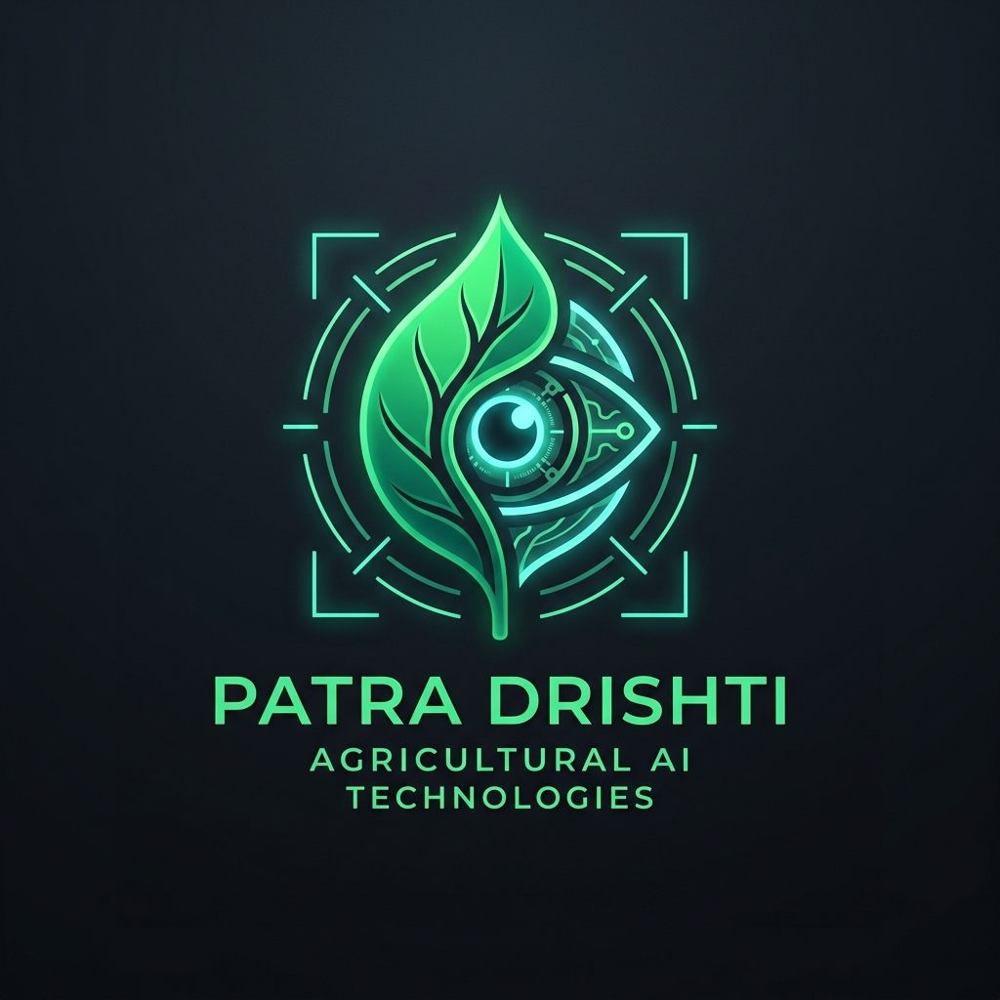

# Patra Drishti (पत्र दृष्टि) 🌿
### *AI-Powered Botanical Vision & Pathology Advisor — Seeing Beyond the Leaf*

[](https://patra-drishti-ai.streamlit.app/)
[](https://patra-drishti-ai.streamlit.app/)
[](https://www.python.org/)
[](https://github.com/ultralytics/ultralytics)
[](https://build.nvidia.com)
[](LICENSE)

<div align="center">
  
  <p><em>"Seeing Beyond the Leaf: YOLOv11 Computer Vision + NVIDIA Multimodal AI Pathologist."</em></p>
  <p>
    <a href="https://patra-drishti-ai.streamlit.app/" target="_blank">
      
    </a>
  </p>
  <p><strong>🌐 Live Cloud Deployment:</strong> <a href="https://patra-drishti-ai.streamlit.app/">https://patra-drishti-ai.streamlit.app/</a></p>
</div>

---

## 🌐 Live Web Application

The production application is deployed 24/7 on Streamlit Cloud:  
👉 **[https://patra-drishti-ai.streamlit.app/](https://patra-drishti-ai.streamlit.app/)**

---

## 🔬 Project Overview

**Patra Drishti (पत्र दृष्टि)** is an end-to-end, two-stage artificial intelligence system engineered for real-time agricultural crop pathology:

1. **Stage 1 (The Eyes):** A fine-tuned **YOLOv11s** object detection model (`best.pt`) optimized for CPU inference that localizes cellular lesions, foliar chlorosis, and healthy leaves in complex real-world field lighting.
2. **Stage 2 (The Brain):** **NVIDIA NIM Multimodal Vision AI (`meta/llama-3.2-11b-vision-instruct`)** and specialized botanical clinical protocols taking raw images and YOLO bounding box telemetry to stream natural-language clinical diagnoses, pathogen etiology, and organic/chemical remediation protocols.

---

## 🌿 PlantDoc Dataset & Class Taxonomy (27 Classes)

Trained on **2,555+ cleaned real-world agricultural images** across 13 crops:

### 🟢 10 Healthy Foliage Varieties
- Apple healthy leaf, Blueberry healthy leaf, Cherry healthy leaf, Grape healthy leaf, Peach healthy leaf, Potato healthy leaf, Raspberry healthy leaf, Soybean healthy leaf, Strawberry healthy leaf, Tomato healthy leaf, Bell Pepper healthy leaf.

### 🔴 17 Pathological Disease Classes
- **Tomato:** Septoria Leaf Spot, Bacterial Spot, Mold Leaf, Late Blight, Early Blight, Yellow Leaf Curl Virus, Mosaic Virus.
- **Corn:** Northern Leaf Blight, Common Rust, Gray Leaf Spot.
- **Apple:** Apple Scab, Cedar Apple Rust.
- **Potato:** Potato Late Blight.
- **Grape:** Grape Black Rot.
- **Squash:** Powdery Mildew.
- **Bell Pepper:** Bacterial Leaf Spot.

---

## ⚡ Key Features

- **Live Cloud Deployment:** Accessible anywhere via [https://patra-drishti-ai.streamlit.app/](https://patra-drishti-ai.streamlit.app/).
- **ChatGPT-Style Blue Dot-Matrix Loader:** Animated pulsing black-card grid with live percentage progression (`16%` → `35%` → `51%` → `88%` → `100%`) during neural inference.
- **Real-Time Streaming Consultation:** Multimodal vision clinical advice streamed token-by-token with typewriter animations.
- **CPU Optimized:** Sub-second inference runs cleanly on standard CPUs without GPU dependencies.
- **Interactive Benchmark Gallery:** Includes 20 pre-loaded foliar specimens with neutral labels for blind AI testing across healthy and diseased classes.
- **Mobile Responsive:** Fully optimized layout for smartphones and tablets with touch-friendly controls.

---

## 🚀 Local Development Setup

### 1. Clone Repository
```bash
git clone https://github.com/Cdbrain108/patra-drishti-ai.git
cd patra-drishti-ai
```

### 2. Install Dependencies
```bash
pip install -r requirements.txt
```

### 3. Launch Web Application Locally
```bash
streamlit run app.py
```

---

## 📊 Model Training Evaluation

The repository includes complete training curves and evaluation artifacts from the 60-epoch AdamW training schedule:
- `results.png`: Precision, Recall, Box Loss, and mAP50 curves.
- `confusion_matrix_normalized.png`: Multi-class normalized confusion matrix.
- `PR_curve.png` & `F1_curve.png`: Precision-Recall and F1 confidence curves.

---

## 📜 License
This project is open-source and available under the [MIT License](LICENSE).
